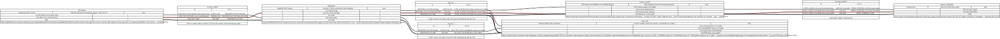
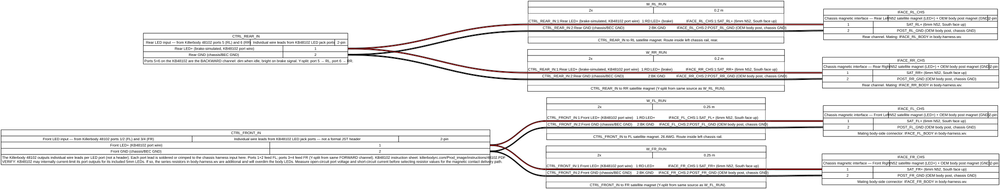
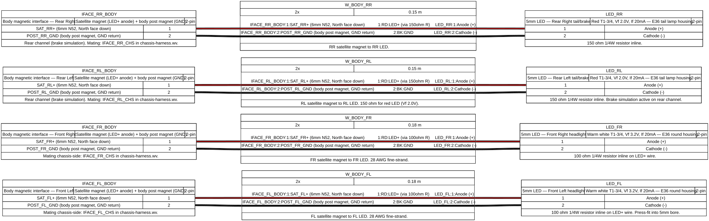

# rc-popstar

Version-controlled build documentation for **Pop Star** — a custom HPI Stage-D10
1/10 RWD electric drift car.

Body: custom BMW E36 cabriolet (3D printed in TPU, Lila Metallic, chrome/yellow graphics)
Electronics: Hobbywing XD10 Pro · HPI FLX-D10 10.5T · Killerbody LED system
Venue: RC Car World, Cinnaminson NJ (indoor drift competition + practice)

Diagrams are authored in [WireViz](https://github.com/wireviz/WireViz) YAML format —
plain text, git-diffable, outputs SVG/PNG/HTML/BOM automatically.

> **Shopping list and build plan:** [`../shopping-list.md`](../shopping-list.md) — parts, prices (renderer-verified), body plan, and suspension notes.
> This repo is the authoritative source for LED system wiring, connector assignments, and magnet contact interface design.

---

## LED System — Magnetic Contact Interface

Pop Star uses a chassis-side LED harness that connects to the body shell magnetically.
When the body is placed on the chassis, the magnetic attachment and the LED circuit
closure are the same motion — no separate plug step.

**How it works:**

| Contact point (per corner) | Conductor | Role |
|---|---|---|
| N52 satellite disc magnet (new, 6mm) | LED+ (hot) | Chassis magnet attracts body magnet → circuit complete |
| OEM D10 body post magnet (existing) | GND return | Already chassis ground, no added wire chassis-side |

When the body seats: satellite magnets align → LED+ path closes. Body post magnets align → GND return closes. All four corners light up simultaneously.

See **[`docs/magnetic-contact-design.md`](docs/magnetic-contact-design.md)** for full magnet spec, polarity convention, bracket design, resistor values, and build sequence.

See **[`docs/build-decisions.md`](docs/build-decisions.md)** for the full decision tree: gyro variants, LED controller options, BEC voltage vs resistor selection, and channel conflict maps.

---

## Diagrams

Click any link to view the interactive diagram with full BOM in your browser.

### System harness (default build: D-Box3 Lite gyro)

| Harness | Interactive HTML | Source |
|---|---|---|
| LED controller: XD10 Pro BEC → Killerbody 48102 (CH1/CH2 Y-cables) → port outputs | [led-controller.html](https://htmlpreview.github.io/?https://github.com/wesleyxcooper/rc-fleet/blob/main/rc-popstar/output/led-controller.html) | `harnesses/led-controller.wv` |
| Chassis harness: KB48102 port outputs → 4× chassis-side magnetic interfaces | [chassis-harness.html](https://htmlpreview.github.io/?https://github.com/wesleyxcooper/rc-fleet/blob/main/rc-popstar/output/chassis-harness.html) | `harnesses/chassis-harness.wv` |
| Body harness: 4× body-side magnetic interfaces → LED headlight + tail assemblies | [body-harness.html](https://htmlpreview.github.io/?https://github.com/wesleyxcooper/rc-fleet/blob/main/rc-popstar/output/body-harness.html) | `harnesses/body-harness.wv` |

### Gyro variant channel maps

| Variant | Interactive HTML | Source |
|---|---|---|
| D-Box3 Pro gyro (adds PCA + AGS dials) | [gyro-dbox3-pro.html](https://htmlpreview.github.io/?https://github.com/wesleyxcooper/rc-fleet/blob/main/rc-popstar/output/gyro-dbox3-pro.html) | `harnesses/gyro-dbox3-pro.wv` |
| Yokomo DP-302 V4 gyro (4 modes, S.BUS gain) | [gyro-yokomo-dp302v4.html](https://htmlpreview.github.io/?https://github.com/wesleyxcooper/rc-fleet/blob/main/rc-popstar/output/gyro-yokomo-dp302v4.html) | `harnesses/gyro-yokomo-dp302v4.wv` |

> Click any diagram to open the full interactive WireViz HTML view via htmlpreview.

### LED controller

[](https://htmlpreview.github.io/?https://github.com/wesleyxcooper/rc-fleet/blob/main/rc-popstar/output/led-controller.html)

The Hobbywing XD10 Pro ESC provides BEC power (5–7.4V adjustable, item 1G) to the
receiver and all servos — no separate BEC. The Killerbody 48102 box reads **CH1
(steering) via Y-cable** and **CH2 (throttle) via Y-cable**, per the KB48102 instruction
sheet. The D-Box3 Lite gyro sits inline between receiver CH1 and the steering servo.

> **BEC source:** XD10 Pro ESC only. The manual states: "no separate battery can be
> connected to the receiver — otherwise, your ESC may be damaged."
> Source: [XD10 Pro manual, wiring section](https://www.hobbywing.com/en/uploads/file/20221012/7cb44bc6cf370ca8bb8ac96c29b6a7e3.pdf)

> **Killerbody 48102 compatibility:** The instruction sheet warns "Not all the Radio
> Controller System compatible with this LED control box." R7FG + RC6GS V3 compatibility
> is unconfirmed — bench-test before installing.
> Source: [KB48102 instruction sheet](http://www.killerbodyrc.com/Prod_image/instructions/48102.PDF)

### Chassis harness

[](https://htmlpreview.github.io/?https://github.com/wesleyxcooper/rc-fleet/blob/main/rc-popstar/output/chassis-harness.html)

KB48102 port outputs (individual wire leads, not JST headers) route to four chassis-side
magnetic contact interfaces. Y-split topology: ports 1+2 feed FL, ports 3+4 feed FR,
port 5 feeds RL, port 6 feeds RR. OEM D10 body post magnets serve as chassis GND.

> **Open item:** KB48102 may internally current-limit its port outputs. Measure open-circuit
> port voltage and short-circuit current before finalizing body-harness.wv resistor values.

### Body harness

[](https://htmlpreview.github.io/?https://github.com/wesleyxcooper/rc-fleet/blob/main/rc-popstar/output/body-harness.html)

Body-shell wiring from magnetic contact interfaces to 5mm LED assemblies. Resistor values
in the file assume 5V BEC. Set XD10 Pro BEC voltage (item 1G) first, then verify:

| BEC setting | White LED (Vf 3.2V) | Red LED (Vf 2.0V) |
|---|---|---|
| 5.0V | 100Ω | 150Ω |
| 6.0V | 150Ω | 200Ω |
| 7.4V | 220Ω | 270Ω |

---

## Harnesses

| File | Description |
|---|---|
| `harnesses/led-controller.wv` | Main system harness: XD10 Pro BEC + receiver → D-Box3 Lite gyro + KB48102 LED box |
| `harnesses/chassis-harness.wv` | KB48102 port outputs → 4× chassis-side satellite magnet contacts |
| `harnesses/body-harness.wv` | 4× body-side magnet contacts → LED headlight and tail assemblies |
| `harnesses/gyro-dbox3-pro.wv` | Variant: D-Box3 Pro gyro channel map (adds PCA + AGS dials) |
| `harnesses/gyro-yokomo-dp302v4.wv` | Variant: Yokomo DP-302 V4 channel map (4 modes, S.BUS dual gain via CH7) |

---

## Key components

| Part | Role | Source |
|---|---|---|
| Hobbywing XD10 Pro | Sensored brushless ESC, BEC 5–7.4V | AMain, $159.99 |
| Radiolink RC6GS V3 | 7-channel transmitter | Amazon, $74.99 |
| Radiolink R7FG | 7ch receiver, PWM/PPM/SBUS, built-in gyro (leave OFF) | Included with RC6GS V3 |
| HPI D-Box3 Lite (161068) | Drift gyro, GAIN dial, CH1+CH4 | AMain, $29.99 |
| HPI D-Box3 Pro (161069) | Drift gyro, adds PCA+AGS dials, CH1+CH4 | AMain, $36.99 |
| Yokomo DP-302 V4 | Drift gyro, 4 modes, S.BUS gain, CH1+CH7 | AMain, $75.99 |
| Killerbody 48102 | LED control box, 12× 5mm LEDs (white/red/yellow/blue) | AMain, ~$17 |
| N52 NdFeB disc 6mm × 3mm | Satellite magnet contacts (8 required) | K&J Magnetics D62 or equiv |
| 5mm warm white LED | Headlight assemblies (FL, FR) | Killerbody kit or supplement |
| 5mm red LED | Tail lamp assemblies (RL, RR) | Killerbody kit or supplement |

---

## Setup

```bash
brew install graphviz      # macOS — required by WireViz
pip install -r requirements.txt
```

Generate all diagrams:

```bash
wireviz harnesses/*.wv -o output/
```

Output files go to `output/` — SVGs and HTML are committed to the repo. PNGs and
raw `.gv` DOT files are gitignored.

---

## Related

- [e36-wiring](https://github.com/wesleyxcooper/e36-wiring) — full-size E36 Pop Star wiring (MaxxECU · ZF 8HP70 · Gauge.S cluster)
- [e36-build-docs](https://github.com/wesleyxcooper/e36-build-docs) — E36 build plan, BOM, walkthroughs
