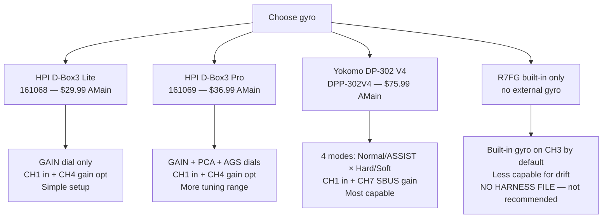
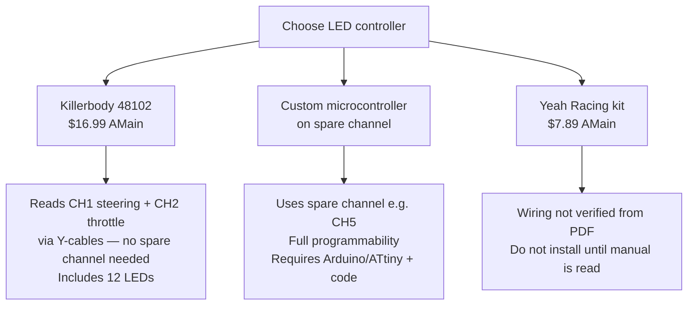
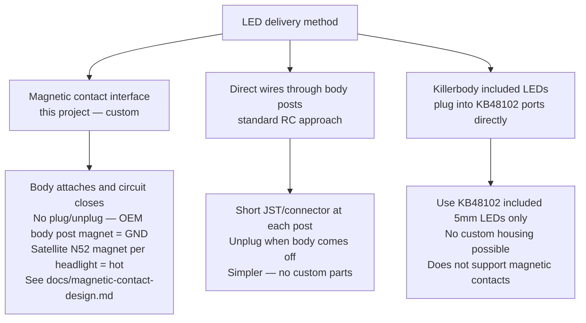

# Pop Star RC — Build Decision Tree

All specs pulled from primary sources (manufacturer PDFs). No assumed values.

---

## How to read this doc

Each decision point is a fork. Pick one branch per category and follow its channel map.
Each variant also has a corresponding WireViz `.wv` file in `harnesses/`.

---

## Decision 1 — Gyro

| | D-Box3 Lite | D-Box3 Pro | Yokomo DP-302 V4 |
|---|---|---|---|
| Price | $29.99 | $36.99 | $75.99 |
| Gain control | Onboard dial or CH4 | Onboard dial or CH4 | Onboard + S.BUS (CH7) |
| Extra dials | None | PCA + AGS | Soft/Hard mode via S.BUS |
| Channels used | CH1 (+ CH4 opt) | CH1 (+ CH4 opt) | CH1 (+ CH3/CH7 opt) |
| Harness file | `led-controller.wv` (default) | `gyro-dbox3-pro.wv` | `gyro-yokomo-dp302v4.wv` |
| Manual | [hpiracing.com](https://www.hpiracing.com/assets/documents/manuals/d_box3_gyro/161068_006_sg_dbox3_gyro_en.pdf) | same | [teamyokomo.com](https://teamyokomo.com/downloadfiles/!02!MANUAL/!02!ELECTRONICS/DP-302V4_User_manual.pdf) |

**R7FG built-in gyro conflict — applies to ALL external gyro choices:**
The R7FG receiver has a built-in gyro (factory default = OFF). If enabled alongside an
external gyro, both correct CH1 simultaneously → oscillation and loss of control.
Leave R7FG gyro OFF at all times when using D-Box3 or Yokomo.
Source: R7FG manual, [radiolink.com](https://radiolink.com.cn/download/3edba11a28636d2f5f2f6002d04a92aa.pdf):
> "Factory setting is gyro function OFF by default."

---

## Decision 2 — LED controller

**Killerbody 48102 wiring — confirmed from PDF (`killerbodyrc.com/Prod_image/instructions/48102.PDF`):**
> "CH1 connects to the steering servo port (requires a Y-shaped cable), CH2 connects to the receiver."

| Port on box | Function | Trigger |
|---|---|---|
| 1 / 2 / 3 / 4 | FORWARD lights (white) | Forward throttle on CH2 |
| 5 / 6 | BACKWARD lights (red) | Reverse throttle on CH2; dim when idle |
| L | Left turn (yellow) | Left steering input on CH1 |
| R | Right turn (yellow) | Right steering input on CH1 |

**Compatibility caveat (verbatim from PDF):**
> "Not all the Radio Controller System compatible with this LED control box."

R7FG compatibility with KB48102 is unconfirmed by Killerbody. Both use standard PWM;
likely compatible, but bench-test on the workbench before cutting the body for LED housings.

---

## Decision 3 — LED delivery to body

Magnetic contact approach (Option 3) is documented in `docs/magnetic-contact-design.md`.
Requires 3D-printed magnet brackets on chassis side + matching pockets in the Blender body model.

---

## Decision 4 — ESC BEC voltage (affects resistor selection in body-harness.wv)

XD10 Pro BEC is adjustable 5V–7.4V in 0.1V steps (programmable item 1G).
Source: XD10 Pro manual features list — [hobbywing.com](https://www.hobbywing.com/en/uploads/file/20221012/7cb44bc6cf370ca8bb8ac96c29b6a7e3.pdf).

**Set BEC voltage before finalizing body-harness.wv resistor values.**

Resistor values for 20mA LED current (rounded to E12 series):

| BEC voltage | White LED (Vf 3.2V) | Red LED (Vf 2.0V) |
|---|---|---|
| 5.0V | 100 Ω | 150 Ω |
| 6.0V | 150 Ω | 200 Ω |
| 7.4V | 220 Ω | 270 Ω |

**Critical open item:** The KB48102 control box may internally current-limit its LED port
outputs. If it does, the series resistors above would stack and overdim the body LEDs.
Measure the KB48102 port open-circuit voltage and short-circuit current before committing
to resistor values. This must be done before body-harness.wv resistor values are treated
as final.

---

## Full channel map by variant

### Variant A — D-Box3 Lite + KB48102 (current default, `led-controller.wv`)

| CH | Control on TX | Device on RX | Notes |
|---|---|---|---|
| CH1 | Steering wheel | D-Box3 Lite in + KB48102 CH1 (Y-cable) | Gyro inline to servo |
| CH2 | Throttle trigger | XD10 Pro ESC + KB48102 CH2 (Y-cable) | ESC BEC supplies VCC |
| CH3 | VR knob | **FREE** | R7FG built-in gyro must be OFF |
| CH4 | SwA momentary | D-Box3 Lite gain (single-wire, optional) | Disables onboard GAIN dial |
| CH5 | SwB 3-way | FREE | |
| CH6/PPM | SwC 3-way | FREE | |
| CH7/SBUS | SwD momentary | FREE | |

### Variant B — D-Box3 Pro + KB48102 (`gyro-dbox3-pro.wv`)

Same as A. D-Box3 Pro adds PCA and AGS dials (hardware, no extra channel needed).
CH4 optional for remote gain — same as Lite.

### Variant C — Yokomo DP-302 V4 + KB48102 (`gyro-yokomo-dp302v4.wv`)

| CH | Control on TX | Device on RX | Notes |
|---|---|---|---|
| CH1 | Steering wheel | DP-302 V4 CH1 + KB48102 CH1 (Y-cable) | Gyro inline to servo |
| CH2 | Throttle trigger | XD10 Pro ESC + KB48102 CH2 (Y-cable) | ESC BEC supplies VCC |
| CH3 | VR knob | DP-302 V4 CH3 (optional) | Conflicts with R7FG default gyro CH3 — must disable R7FG gyro and reassign VR knob in GYRO menu to STD |
| CH4 | SwA momentary | FREE | |
| CH5 | SwB 3-way | FREE | |
| CH6/PPM | SwC 3-way | FREE | |
| CH7/SBUS | SwD momentary | DP-302 V4 dual gain (S.BUS) | Enable S.BUS: press binding button once on R7FG |

---

## Open items before first run

- [ ] Pick gyro variant (see Decision 1 above)
- [ ] Set XD10 Pro BEC voltage (item 1G) and record the value
- [ ] Bench-test KB48102 port output voltage/current (see Decision 4 note)
- [ ] Finalize resistor values in `body-harness.wv` based on BEC + KB48102 measurements
- [ ] Bench-test KB48102 with RC6GS V3 + R7FG before body install
- [ ] Run gyro EPA setup (D-Box3: hold SET 2s → steer limits; Yokomo: hold SW + power on)
- [ ] Verify R7FG built-in gyro is OFF (factory default; do not enable)
- [ ] If using Yokomo + CH7 gain: enable S.BUS on R7FG by pressing binding button once

## Sources

| Component | Manual URL | Format |
|---|---|---|
| HPI Stage-D10 (chassis) | [hpiracing.com](https://www.hpiracing.com/assets/documents/manuals/stage_d10/161002_006_ug_stage_d10_en.pdf) | PDF (text) |
| HPI Stage-D10 setup sheet | [hpiracing.com](https://www.hpiracing.com/assets/documents/setup_sheets/stage_d10/brushed_stage_d10_rtr_setup_sd10v4_flat.pdf) | PDF (text) |
| Hobbywing XD10 Pro ESC | [hobbywing.com](https://www.hobbywing.com/en/uploads/file/20221012/7cb44bc6cf370ca8bb8ac96c29b6a7e3.pdf) | PDF (text) |
| Radiolink RC6GS V3 + R7FG | [radiolink.com](https://radiolink.com.cn/download/3edba11a28636d2f5f2f6002d04a92aa.pdf) | PDF (text) |
| HPI D-Box3 Lite/Pro | [hpiracing.com](https://www.hpiracing.com/assets/documents/manuals/d_box3_gyro/161068_006_sg_dbox3_gyro_en.pdf) | PDF (text) |
| Yokomo DP-302 V4 | [teamyokomo.com](https://teamyokomo.com/downloadfiles/!02!MANUAL/!02!ELECTRONICS/DP-302V4_User_manual.pdf) | PDF (scanned image, read via browser) |
| Killerbody 48102 LED kit | [killerbodyrc.com](http://www.killerbodyrc.com/Prod_image/instructions/48102.PDF) | PDF (text) |
